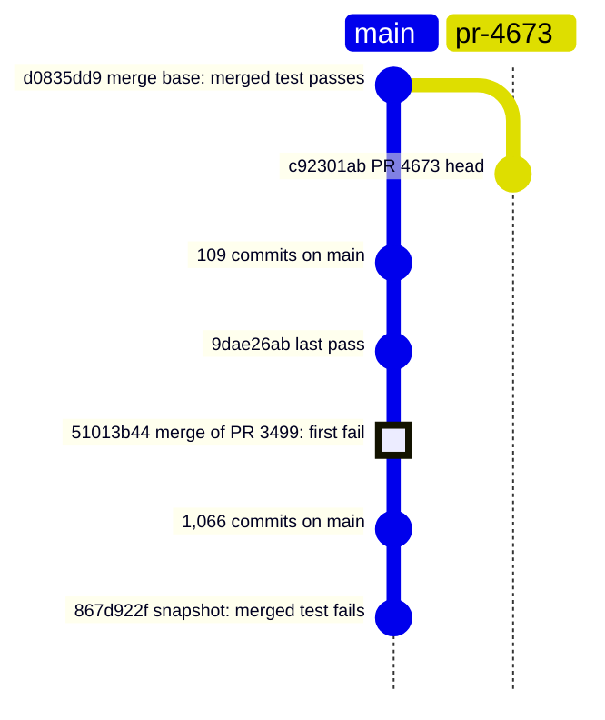
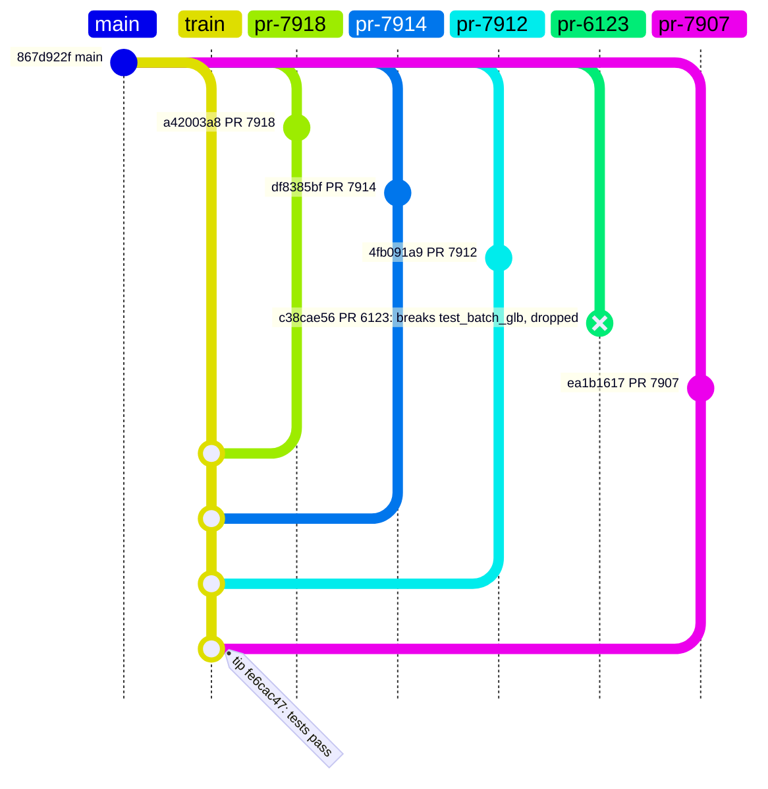
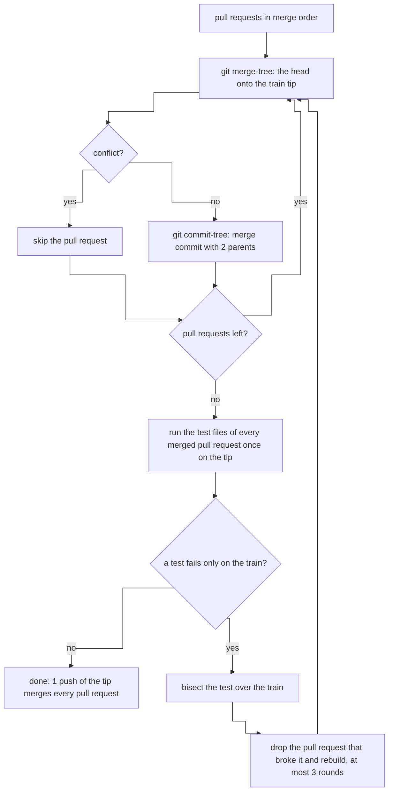

# pullrequest-sandbox

Test a pull request the way it will land: merged with the newest `main`, inside a throwaway Docker container that
has no network and cannot change a file on the host.

[](LICENSE)
[](merge-sweep/sweep.py)
[](bin/sandbox-run)
[](tests/check_sandbox.sh)

[Polski](README.pl.md) | [Tools](#tools) | [Demo](#demo) | [Results](#results) | [Quick start](#quick-start) |
[How it works](#how-it-works) | [Graphs](#graphs) | [Limits](#limits)

Built while I reviewed [ItsNotRexed/Leonida](https://github.com/ItsNotRexed/Leonida), a repository with 4,425 open
pull requests on 2026-11-23 at 21:58 CET. Write-up:
[Testing open pull requests merged with `main`](https://github.com/maciejszulia/maciejszulia/blob/main/case-studies/leonida-merge-sweep.md).

## Tools

| Tool | The question it answers |
| --- | --- |
| [`bin/sandbox-run`](bin/sandbox-run) | How do I run code from a stranger's pull request with no network and without my files? |
| [`merge-sweep/sweep.py`](merge-sweep/sweep.py) | Which open pull requests fail a test only after the merge with `main`? |
| [`merge-sweep/merge-check`](merge-sweep/merge-check) | For 1 pull request and 1 test file: what happens on `main`, merged, and on the head? |
| [`merge-sweep/merge-bisect`](merge-sweep/merge-bisect) | Which commit on `main` does the pull request have to catch up with? |
| [`merge-sweep/train.py`](merge-sweep/train.py) | Which pull requests can go to `main` together in 1 push without breaking a test? |
| [`tests/check_sandbox.sh`](tests/check_sandbox.sh) | Does the sandbox hold? No network, source unchanged, self-checks of the bisection and the train. |

## Demo

[`merge-check`](merge-sweep/merge-check) runs 1 test file of
[PR #4734](https://github.com/ItsNotRexed/Leonida/pull/4734) 3 times. The file passes on the PR head alone and fails
once the head is merged with `main` (2026-11-23, 20:01 UTC):

```
$ merge-sweep/merge-check 4734 tests/test_find_hash_lookup.py
===== main snapshot (867d922f09b86583859796a174df89555fb32da8)
Ran 5 tests in 0.344s
OK
exit=0
===== main + PR #4734 head 40ac5f600 (49b3783ba28158e6654ba5c329c41075f8a3f944)
Ran 6 tests in 0.590s
FAILED (failures=3)
exit=1
===== PR #4734 head (40ac5f6000fd3d20c17eb5159d8b26954f1720b0)
Ran 5 tests in 0.253s
OK
exit=0
```

## Results

ItsNotRexed/Leonida, 2026-11-23, on a ThinkPad T470p (i7-7700HQ, 32 GB RAM, Docker 29.10.0). Every number, its
commit and its time: [results/2026-11-23-leonida.md](results/2026-11-23-leonida.md).

| What | Count |
| --- | --- |
| open pull requests merge-checked by `sweep.py` (`main` at [`dde82f27`](https://github.com/ItsNotRexed/Leonida/commit/dde82f27e994337094afc476ded0b1426f6e87e2), 3 workers, 86 min) | 1,667 |
| of them: merge conflict with `main` | 304 |
| candidate test files: fail merged, pass on `main` or are new | 37 in 36 pull requests |
| still failing only after the merge with `main` at [`6312c057`](https://github.com/ItsNotRexed/Leonida/commit/6312c057f88f5627108643e3e1f572d18232c8d2) | 15 |
| of them: `merge-bisect` named the exact commit on `main` to catch up with | 14 |
| `train.py` on 5 pull requests: dropped, merged in 1 tip, run time | 1, 4, 94 s |

## Quick start

Needs Linux, Docker, git 2.38 or newer and, for the sweep, the GitHub CLI (`gh`).

```sh
git clone https://github.com/maciejszulia/pullrequest-sandbox.git && cd pullrequest-sandbox
cp <target repo>/tests/requirements.txt image/requirements.txt   # optional: the target's test packages
docker build -t pullrequest-sandbox:py312 image
tests/check_sandbox.sh                                           # no network, source unchanged, self-checks
bin/sandbox-run ~/lab/<repo> 'python -I tests/test_something.py'
```

Check the open pull requests of 1 repository:

```sh
git clone https://github.com/<owner>/<repo>.git ~/lab/<repo>-sweep
export SWEEP_REPO=<owner>/<repo> SWEEP_CLONE=~/lab/<repo>-sweep SWEEP_DIR=~/lab/<repo>-state
merge-sweep/sweep.py prepare                  # fetch main, list the pull requests to check
merge-sweep/sweep.py run                      # results.jsonl, candidates.jsonl, baseline.json in SWEEP_DIR
merge-sweep/merge-check <pr> <test file>      # 1 candidate on main, merged and on the head
merge-sweep/merge-bisect <pr> <test file>     # the commit on main after which the merged test fails
merge-sweep/train.py <pr> <pr> ...            # merge train: drop each pull request that breaks a test
```

## How it works

1. [`bin/sandbox-run`](bin/sandbox-run) mounts the folder read-only, copies it into a tmpfs and runs the command
   with `--network none`, `--cap-drop ALL`, `no-new-privileges`, a non-root user and limits for memory, CPU and
   processes. `/work` becomes a throwaway git repository, so tests that list tracked files work.
2. [`merge-sweep/sweep.py`](merge-sweep/sweep.py) fetches each pull request head and merges it into 1 `main`
   snapshot with `git merge-tree --write-tree` (no working tree). `git archive` streams the merged tree into the
   container, and [`merge-sweep/run_pr.sh`](merge-sweep/run_pr.sh) runs the test files the pull request touches.
   A file that fails runs once more on `main`; a candidate passes on `main` (or is new) and fails merged.
3. [`merge-sweep/merge-check`](merge-sweep/merge-check) prints the full output of 1 candidate on `main`, merged and
   on the head.
4. [`merge-sweep/merge-bisect`](merge-sweep/merge-bisect) bisects the first-parent history of `main` between the
   merge base and the snapshot. Each step merges 1 commit of `main` with the head and runs the test. A step whose
   merge conflicts is skipped for its nearest neighbour, and the output says whether the result is exact.
5. [`merge-sweep/train.py`](merge-sweep/train.py) merges a list of pull requests onto `main` locally
   (`git merge-tree`, then `git commit-tree` with 2 parents), runs the test files of every merged pull request once
   on the tip, bisects each test that fails only on the train, drops the pull request that broke it and rebuilds,
   for at most 3 rounds. It pushes nothing: 1 push of the tip puts the whole train on `main`, and GitHub marks every
   pull request whose head reaches `main` as merged.

## Graphs

`merge-bisect` on [PR #4673](https://github.com/ItsNotRexed/Leonida/pull/4673): the test passes on the merge base
and fails merged with the snapshot. 11 steps (31 s) over 1,176 first-parent commits of `main` named
[`51013b44`](https://github.com/ItsNotRexed/Leonida/commit/51013b44bf178c68ac4e154713bc7aea9202aab9):



`train.py` on 5 pull requests (94 s): round 1 merged all 5 and `tests/test_batch_glb.py` failed only on the train;
the bisection named [PR #6123](https://github.com/ItsNotRexed/Leonida/pull/6123); round 2 rebuilt the train without
it and every test passed:





Which commit on `main` breaks which open pull request:
[results, graph and table](results/2026-11-23-leonida.md#which-merge-on-main-breaks-which-pr).

## Limits

- The container shares the host kernel. It keeps the code off the network and off the host files; it is a review
  sandbox, not a boundary against code that attacks Docker or the kernel.
- `git merge-tree`, `git archive` and `gh` run on the host and read the untrusted objects, as every clone does.
- [`merge-sweep/run_pr.sh`](merge-sweep/run_pr.sh) picks the test runner by the CI rule of ItsNotRexed/Leonida:
  pytest for a file with `import pytest` or without a `__main__` block, `unittest discover` for `tests/semantic`,
  `python -I` for the rest. Another repository needs that block changed.
- The sweep checks only pull requests that change `.py` and `.md` files and touch `tests/`. Tests that need a GPU,
  Windows or files outside the repository are not covered.

## Related

- [Controlled English](https://github.com/maciejszulia/controlled-english), module S: claims, findings and test
  reports that name the tree they tested, for example "Tested `<head>` merged with `main` at `<sha>`".
- The proposal to the Leonida maintainers: [issue #9038](https://github.com/ItsNotRexed/Leonida/issues/9038).

## License and author

MIT. Maciej Szulia.
