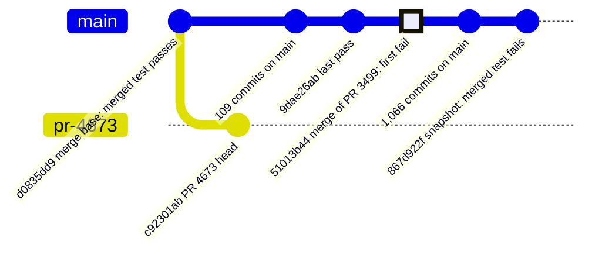
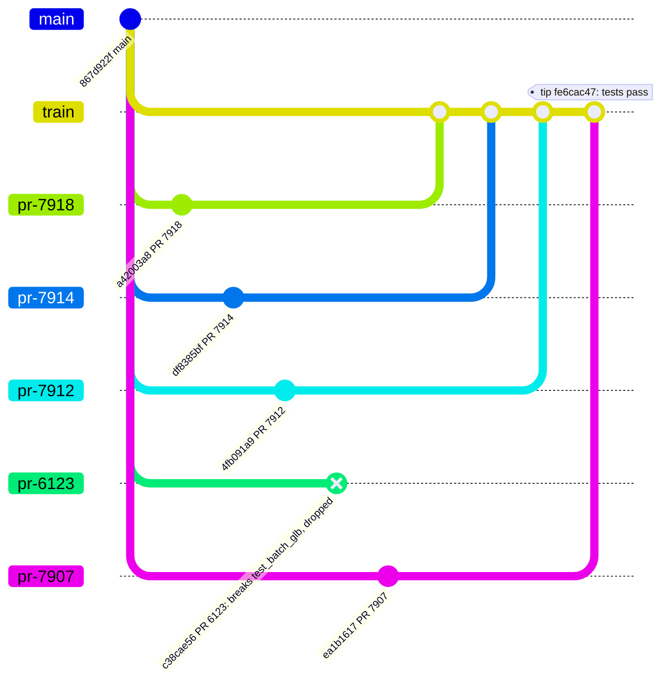
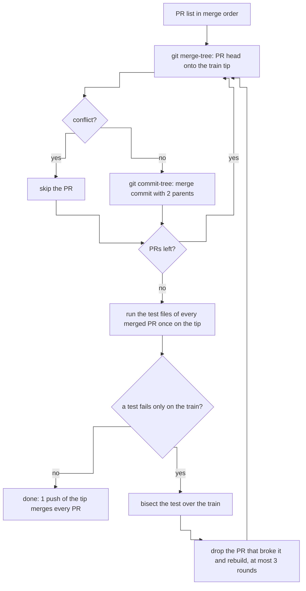

# pr-sandbox

Runs untrusted repository code, and checks open pull requests against the current `main`, inside throwaway Docker
containers that have no network and cannot change the files on the host.

## Demo

`merge-check` runs one test file of a pull request three times: on `main`, on `main` merged with the PR (the same
3-way merge GitHub does) and on the PR head alone. This PR passes on its own head and breaks once merged:

```
$ merge-sweep/merge-check 4734 tests/test_find_hash_lookup.py
===== main snapshot (dde82f27e994337094afc476ded0b1426f6e87e2)
Ran 5 tests in 0.895s
OK
exit=0
===== main + PR #4734 head 40ac5f600 (845a9f72676e53cffaa5cfc4daee6e80af35ff55)
Ran 6 tests in 1.616s
FAILED (failures=3)
exit=1
===== PR #4734 head (40ac5f6000fd3d20c17eb5159d8b26954f1720b0)
Ran 5 tests in 0.851s
OK
exit=0
```

## Results

First run on [ItsNotRexed/Leonida](https://github.com/ItsNotRexed/Leonida) on 2026-11-23 (ThinkPad T470p,
i7-7700HQ, Docker 29.10.0). Full numbers and the machine: [results/2026-11-23-leonida.md](results/2026-11-23-leonida.md).

| What | Count |
|---|---|
| standard-library test files failing on `main` (of 438) | 16 |
| open PRs with Python changes and tests | 1,670 |
| PRs merge-checked (3 workers, 86 min) | 1,667 |
| of them: merge conflict with `main` | 304 |
| candidates: a test fails only after the merge | 37 files in 36 PRs |
| candidates triaged so far: real defects / false positives | 4 / 1 |

## Quick start

Needs Linux, Docker, git and the GitHub CLI (`gh`) for the sweep.

```sh
git clone git@github.com:maciejszulia/pr-sandbox.git && cd pr-sandbox
cp <target repo>/tests/requirements.txt image/requirements.txt   # optional: the target's test packages
docker build -t pr-sandbox:py312 image
tests/check_sandbox.sh                                           # no network, source unchanged, git in /work
bin/sandbox-run ~/lab/<repo> 'python -I tests/test_something.py'
```

Sweep the open pull requests of one repository:

```sh
git clone https://github.com/<owner>/<repo>.git ~/lab/<repo>-sweep
export SWEEP_REPO=<owner>/<repo> SWEEP_CLONE=~/lab/<repo>-sweep SWEEP_DIR=~/lab/<repo>-state
merge-sweep/sweep.py prepare       # fetch main, list the PRs to check
merge-sweep/sweep.py run           # results.jsonl, candidates.jsonl, baseline.json in SWEEP_DIR
merge-sweep/merge-check <pr> <test file>
merge-sweep/merge-bisect <pr> <test file>    # the main commit after which the merged test fails
merge-sweep/train.py <pr> <pr> ...           # merge train: test many PRs merged together, drop each PR that breaks a test
```

## How it works

1. `bin/sandbox-run` mounts the folder read-only, copies it into a tmpfs and runs the command with
   `--network none`, `--cap-drop ALL`, `no-new-privileges`, a non-root user and memory, CPU and process limits.
   `/work` becomes a throwaway git repository, so tests that list tracked files work.
2. `merge-sweep/sweep.py run` fetches each PR head, merges it into one `main` snapshot with
   `git merge-tree --write-tree` (no working tree), streams the merged tree into the container with `git archive`
   and runs the test files the PR touches. A failing file is run once more on `main`; a candidate is a file that
   passes on `main` (or is new) and fails merged.
3. `merge-sweep/merge-check` shows the full output of one candidate on `main`, merged and on the PR head.
4. `merge-sweep/merge-bisect` bisects the first-parent history of `main` between the PR's merge base and the snapshot:
   each step merges 1 `main` commit with the PR head and runs the test. The result names the merge on `main` that
   the PR has to catch up with. A step whose merge conflicts is skipped for its nearest neighbour; the output says
   whether the result is exact.
5. `merge-sweep/train.py` merges a list of PRs onto `main` locally (`git merge-tree`, then `git commit-tree` with 2
   parents), runs the test files of every merged PR once on the train tip, bisects each test that fails only on the
   train, drops the PR that broke it and rebuilds, for at most 3 rounds. It pushes nothing: 1 push of the tip puts
   the whole train on `main`, and GitHub marks every PR whose head reaches `main` as merged.

## Graphs

`merge-bisect` on PR #4673 (2026-11-23): the PR's test passes on the merge base and fails merged with the snapshot.
Bisection over 1,176 first-parent commits of `main` found the merge that the PR has to catch up with in 11 steps
(31 s):



`train.py` on 5 PRs (2026-11-23, 94 s): round 1 merged all 5 and `tests/test_batch_glb.py` failed only on the
train; bisection named PR #6123; round 2 rebuilt the train without it and every test passed:





Which merge on `main` breaks which open PR: [results/2026-11-23-leonida.md](results/2026-11-23-leonida.md#which-merge-on-main-breaks-which-pr).

## Limits

- The container shares the host kernel. It keeps the code off the network and off the host files; it is a review
  sandbox, not a boundary against code that attacks Docker or the kernel.
- `git merge-tree`, `git archive` and `gh` run on the host and read the untrusted objects, as any clone does.
- Test selection in `merge-sweep/run_pr.sh` follows the CI rule of ItsNotRexed/Leonida (pytest for files with
  `import pytest` or no `__main__` block, `python -I` for the rest). Another repository needs that block changed.
- The sweep checks only PRs that change `.py` and `.md` files and touch `tests/`. Tests that need a GPU, Windows or
  files outside the repository are not covered.

## License and author

MIT. Maciej Szulia.
