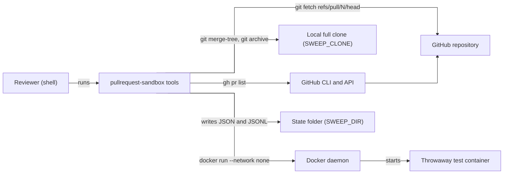
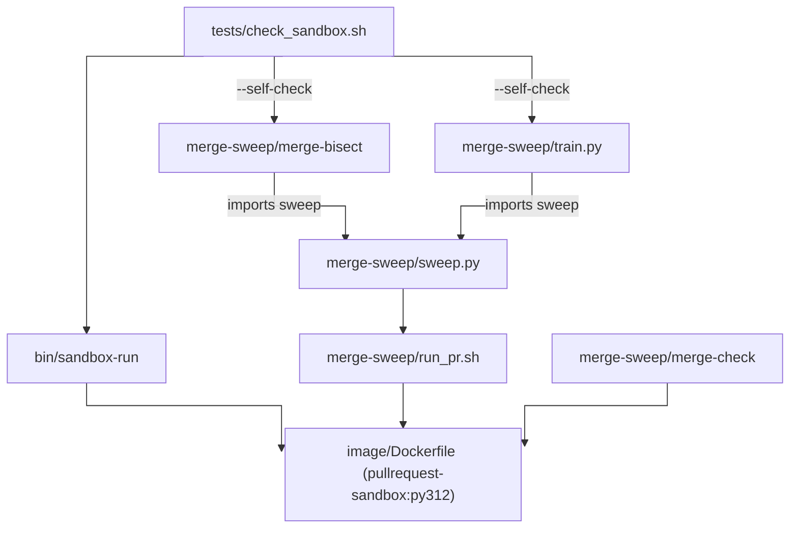
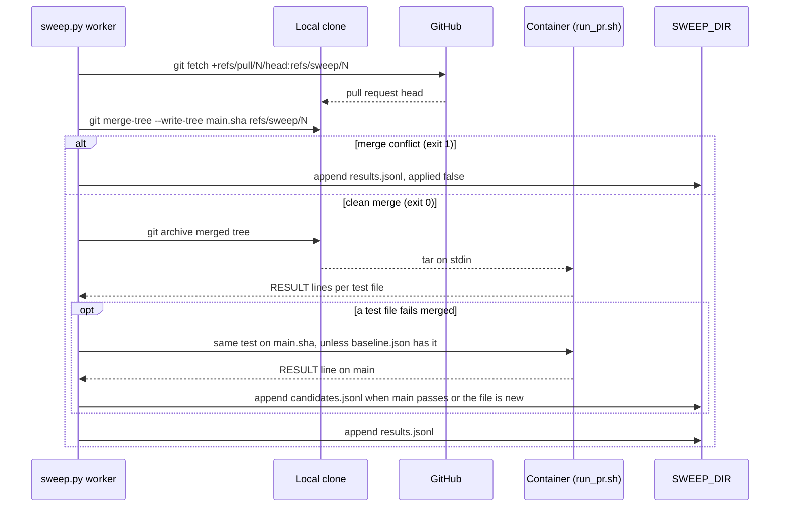

# pullrequest-sandbox: architecture

This document describes the architecture of `pullrequest-sandbox` in the arc42 layout. It covers the code on the
default branch. Every statement names the file that shows it.

## 1. Introduction and goals

`pullrequest-sandbox` tests a pull request the way it will land: merged with the newest `main`, inside a throwaway
Docker container that has no network and cannot change a file on the host ([README.md](../../README.md)).

Goals:

| Goal | Where it shows |
| --- | --- |
| Run untrusted pull request code without network access and without write access to host files | [`bin/sandbox-run`](../../bin/sandbox-run), [`tests/check_sandbox.sh`](../../tests/check_sandbox.sh) |
| Find open pull requests whose tests fail only after the merge with `main` | [`merge-sweep/sweep.py`](../../merge-sweep/sweep.py) |
| Name the commit on `main` that a failing pull request has to catch up with | [`merge-sweep/merge-bisect`](../../merge-sweep/merge-bisect) |
| Find a set of pull requests that can land together in 1 push | [`merge-sweep/train.py`](../../merge-sweep/train.py) |

Stakeholders: a reviewer or maintainer of a repository with many open pull requests. The first target was
`ItsNotRexed/Leonida` ([results/2026-11-23-leonida.md](../../results/2026-11-23-leonida.md)).

## 2. Constraints

| Constraint | Evidence |
| --- | --- |
| Linux, Docker, git 2.38 or newer; the GitHub CLI (`gh`) for the sweep | [README.md](../../README.md), section "Quick start" |
| Python scripts use the standard library only | imports in [`merge-sweep/sweep.py`](../../merge-sweep/sweep.py) and [`merge-sweep/train.py`](../../merge-sweep/train.py) |
| The test image is `python:3.12-slim` with `git`, `spirv-tools` and the target's test packages | [`image/Dockerfile`](../../image/Dockerfile), [`image/requirements.txt`](../../image/requirements.txt) |
| The image is built once with network; containers run with `--network none` | [`image/Dockerfile`](../../image/Dockerfile) |
| `sandbox-run` accepts only a folder inside `SANDBOX_ROOTS` (default `$HOME/lab` and `$TMPDIR` or `/tmp`) | [`bin/sandbox-run`](../../bin/sandbox-run) |
| The sweep checks only pull requests that are not drafts, change only `.py` and `.md` files and touch `tests/` | `prepare()` in [`merge-sweep/sweep.py`](../../merge-sweep/sweep.py) |
| License: MIT | [LICENSE](../../LICENSE) |

## 3. Context and scope

The tools run on the reviewer's host. The host talks to GitHub (git fetch and `gh pr list`) and to the local
Docker daemon. Untrusted code runs only inside containers.

In scope: running tests of pull requests in a container, merge checks, bisection over `main`, a local merge train.
Out of scope: pushing to the target repository (`train.py` prints the push command and pushes nothing), posting
review comments, and isolation against code that attacks Docker or the kernel ([README.md](../../README.md),
section "Limits").

## 4. Solution strategy

| Problem | Approach | Evidence |
| --- | --- | --- |
| Untrusted code | `docker run --rm --network none --cap-drop ALL --security-opt no-new-privileges`, a non-root user, limits for memory, CPU and processes | [`bin/sandbox-run`](../../bin/sandbox-run), `docker()` in [`merge-sweep/sweep.py`](../../merge-sweep/sweep.py) |
| Source must stay unchanged | Mount the folder read-only and copy it into a tmpfs (`sandbox-run`), or stream a tree with `git archive` into a tmpfs (sweep tools) | [`bin/sandbox-run`](../../bin/sandbox-run), [`merge-sweep/run_pr.sh`](../../merge-sweep/run_pr.sh) |
| Merging many pull requests fast | `git merge-tree --write-tree --no-messages` builds the merged tree without a working tree | [ADR 0002](adr/0002-merge-without-working-tree.md) |
| Separating merge failures from failures already on `main` | A test that fails merged runs once more on the `main` snapshot; results are cached in `baseline.json` | `run()` in [`merge-sweep/sweep.py`](../../merge-sweep/sweep.py) |
| Finding the breaking commit | Bisection over first-parent history; unjudgeable steps are skipped for the nearest neighbour | `bisect()` in [`merge-sweep/sweep.py`](../../merge-sweep/sweep.py) |

## 5. Building block view

| Block | Language | Responsibility |
| --- | --- | --- |
| [`bin/sandbox-run`](../../bin/sandbox-run) | Bash | Runs 1 command on 1 folder in a container. `--py 3.13` or `--py 3.14` switches to the `python:<version>-slim` image. |
| [`merge-sweep/sweep.py`](../../merge-sweep/sweep.py) | Python | `prepare`: fetch `main`, record its SHA, list open pull requests. `run`: merge each head, run its tests in parallel workers, write results. Also holds the shared helpers `git()`, `docker()`, `parse()`, `bisect()`, `tests_for()`. |
| [`merge-sweep/run_pr.sh`](../../merge-sweep/run_pr.sh) | Bash | Container side: extracts the tar from stdin and prints 1 `RESULT <exit code> <file> <first failure line>` line per test file. |
| [`merge-sweep/merge-check`](../../merge-sweep/merge-check) | Bash | Runs 1 test file on the `main` snapshot, merged, and on the head; prints the last 60 lines of each run. |
| [`merge-sweep/merge-bisect`](../../merge-sweep/merge-bisect) | Python | Bisects first-parent `main` between the merge base and the snapshot for 1 pull request and 1 test file. |
| [`merge-sweep/train.py`](../../merge-sweep/train.py) | Python | Builds a local merge train, tests the tip, bisects and drops breaking pull requests, at most `ROUNDS` rounds (default 3). Writes `train.json`. |
| [`tests/check_sandbox.sh`](../../tests/check_sandbox.sh) | Bash | Self-check: no network, source unchanged, `/work` is a git repository; then the self-checks of `merge-bisect` and `train.py`. |
| [`image/`](../../image/Dockerfile) | Dockerfile | Test image with Python 3.12, `git`, `spirv-tools` and the target's test packages. |

State files in `SWEEP_DIR` (default `./sweep-state`, ignored by [`.gitignore`](../../.gitignore)): `main.sha`,
`open-prs.json`, `py-prs.json`, `results.jsonl`, `candidates.jsonl`, `baseline.json`, `train.json`, and the stop
flag `STOP` (source: the docstrings and `open()` calls in [`merge-sweep/sweep.py`](../../merge-sweep/sweep.py) and
[`merge-sweep/train.py`](../../merge-sweep/train.py)).

## 6. Runtime view

Main flow: `sweep.py run` checks 1 pull request.

Other flows:

- `merge-bisect <pr> <test>`: checks that the test passes merged with the merge base and fails merged with the
  snapshot, then calls `sweep.bisect()`; each step runs 1 `git merge-tree` and 1 container
  ([`merge-sweep/merge-bisect`](../../merge-sweep/merge-bisect)).
- `train.py <pr> ...`: `git merge-tree` and `git commit-tree` with 2 parents per pull request, 1 test run on the tip,
  bisection over the train for each test that fails only on the train
  ([`merge-sweep/train.py`](../../merge-sweep/train.py)).
- A rerun of `sweep.py run` skips the pull requests that `results.jsonl` already holds; the file `SWEEP_DIR/STOP`
  stops the workers early (docstring of [`merge-sweep/sweep.py`](../../merge-sweep/sweep.py)).

## 7. Deployment view

The tools run from the repository folder on 1 Linux host with Docker. There is no server, no service and no
installation step ([README.md](../../README.md), section "Quick start"). The image is built locally with
`docker build -t pullrequest-sandbox:py312 image`. The sweep runs `WORKERS` containers in parallel (default 3).

| Node | Runs |
| --- | --- |
| Host | Bash and Python scripts, `git`, `gh`, Docker CLI |
| Container (per test run) | `bash`, `python`, `pytest` or `unittest`, on tmpfs `/work` (3 GB) and `/tmp` (1 GB), 2 GB memory, 2 CPUs, 512 processes |

## 8. Crosscutting concepts

- **Isolation.** Every container gets `--network none`, `--cap-drop ALL`, `--security-opt no-new-privileges`,
  `--pids-limit 512` and the host user's UID and GID ([`bin/sandbox-run`](../../bin/sandbox-run),
  [`merge-sweep/sweep.py`](../../merge-sweep/sweep.py), [`merge-sweep/merge-check`](../../merge-sweep/merge-check)).
- **Input validation.** `merge-check` and `merge-bisect` accept only a numeric pull request and a path that matches
  `tests/....py`; `sandbox-run` rejects a folder outside `SANDBOX_ROOTS`.
- **Throwaway git repository.** Tests that list tracked files need a repository, so the container runs
  `git init` and 1 commit on `/work` ([`bin/sandbox-run`](../../bin/sandbox-run),
  [`merge-sweep/run_pr.sh`](../../merge-sweep/run_pr.sh)).
- **Test runner selection.** See [ADR 0004](adr/0004-test-runner-follows-target-ci.md).
- **Result format.** 1 `RESULT` line per test file inside the container; JSON Lines records on the host.
- **Concurrency.** A `ThreadPoolExecutor` with `WORKERS` threads; 1 `threading.Lock` guards the baseline cache and
  the appends to the JSONL files ([`merge-sweep/sweep.py`](../../merge-sweep/sweep.py)).
- **Timeouts.** 240 s per test file in `run_pr.sh`, 300 s in `merge-check`, 1,500 s per container in `sweep.py`.

## 9. Architecture decisions

- [ADR 0001: Run pull request code in a container without network](adr/0001-no-network-container.md)
- [ADR 0002: Merge with `git merge-tree` and stream the tree with `git archive`](adr/0002-merge-without-working-tree.md)
- [ADR 0003: The merge train is local and pushes nothing](adr/0003-local-merge-train.md)
- [ADR 0004: The test runner follows the target repository's CI rule](adr/0004-test-runner-follows-target-ci.md)

## 10. Quality requirements

| Quality | Scenario | Check |
| --- | --- | --- |
| Security | Code in the container tries to open a TCP connection to `1.1.1.1:53`; the connection fails | [`tests/check_sandbox.sh`](../../tests/check_sandbox.sh) |
| Integrity | Code in the container overwrites a file; the source folder on the host keeps the original | [`tests/check_sandbox.sh`](../../tests/check_sandbox.sh) |
| Correctness | Bisection over a fake history with 2 unjudgeable commits returns the non-exact interval `(5, 8)` | `self_check()` in [`merge-sweep/merge-bisect`](../../merge-sweep/merge-bisect) |
| Correctness | A train of 3 pull requests merges 2 and skips 1 on conflict; the tip has 2 parents | `self_check()` in [`merge-sweep/train.py`](../../merge-sweep/train.py) |
| Resumability | A rerun of `sweep.py run` continues after the pull requests in `results.jsonl` | `run()` in [`merge-sweep/sweep.py`](../../merge-sweep/sweep.py) |

## 11. Risks and technical debt

| Risk or debt | Evidence |
| --- | --- |
| The container shares the host kernel; it is not a boundary against code that attacks Docker or the kernel | [README.md](../../README.md), section "Limits" |
| `git merge-tree`, `git archive` and `gh` read untrusted objects on the host | [README.md](../../README.md), section "Limits" |
| The test runner rule is specific to `ItsNotRexed/Leonida`; another repository needs `run_pr.sh` and `merge-check` changed | [`merge-sweep/run_pr.sh`](../../merge-sweep/run_pr.sh) |
| The runner rule is duplicated in `run_pr.sh` and `merge-check` | both files |
| `tests_for()` runs at most 5 test files per pull request; a pull request that touches more is checked partly | `tests_for()` in [`merge-sweep/sweep.py`](../../merge-sweep/sweep.py) |
| `merge-sweep/merge-bisect` and `merge-sweep/train.py` import `sweep`, so they must stay in the same folder | `import sweep` in both files |
| Tests that need a GPU, Windows or files outside the repository are not covered | [README.md](../../README.md), section "Limits" |

### Open questions

- No CI workflow runs `tests/check_sandbox.sh`; the repository has no `.github/workflows` folder. Whether a CI gate
  is planned is not recorded.

## 12. Glossary

| Term | Meaning |
| --- | --- |
| `main` snapshot | The `main` commit recorded in `SWEEP_DIR/main.sha` by `sweep.py prepare` |
| Candidate | A test file that fails with the pull request merged and passes on the `main` snapshot or is new |
| Baseline | Cached result of a test file on the `main` snapshot (`baseline.json`) |
| Merge base | The newest common ancestor of the pull request head and the `main` snapshot |
| Merge train | A chain of local merge commits, 1 per pull request, on top of `main` |
| Tip | The last merge commit of the train |
| Unjudgeable step | A bisection step whose merge conflicts or gives no test result |
