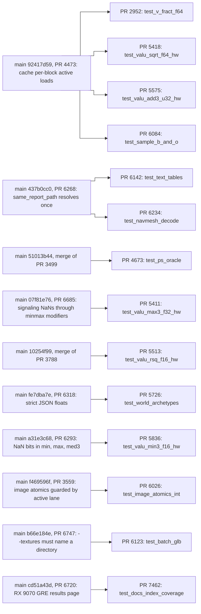

# Run on ItsNotRexed/Leonida, 2026-11-23

Machine: ThinkPad T470p (Intel Core i7-7700HQ, 32 GB RAM), Artix Linux, Docker 29.10.0, image `pr-sandbox:py312`
(Python 3.12.16, pytest 9.2.0, SPIRV-Tools 2025.1). Times are CET.

## Main health (`bin/sandbox-run`, `main` at `3ae06542`, 18:24)

| What | Count |
|---|---|
| standard-library test files that CI runs with `python -I` | 438 |
| of them failing on `main` | 16 |
| failures that already had an open fix PR | 16 |

## Merge sweep (`merge-sweep/sweep.py`, `main` snapshot `dde82f27`, 18:57 to 20:23, 3 workers)

| What | Count |
|---|---|
| open PRs listed by `sweep.py prepare` input (`gh pr list`, 18:47) | 3,229 |
| PRs that change only `.py`/`.md` files and touch `tests/` | 1,670 |
| PRs checked | 1,667 |
| merged cleanly with `git merge-tree` | 1,362 |
| merge conflict | 304 |
| head ref no longer fetchable | 1 |
| candidate test files (fail merged; pass on `main` or new) | 37 |
| PRs with at least 1 candidate | 36 |
| candidates whose test file is new in the PR | 15 |

Triage of the first 5 candidates: 1 false positive (the container had no git repository; fixed in
`merge-sweep/run_pr.sh`), 4 real defects. 3 of them other reviewers had already reported; the fourth (#4734)
was posted as a review comment.

## Which merge on main breaks which PR

Re-check of the 32 untriaged candidates on `main` at `867d922f` (`merge-check`, finished 21:19 CET): 15 test files
still fail only after the merge, 7 also fail on the PR head alone, 4 fail on `main` too, 2 no longer fail, 3 gave
no result (the PR head no longer has the test file) and 1 PR now conflicts. `merge-bisect` named the first failing merge on `main` for 14 of the 15; for
PR #5315 the 502 commits between the last pass (`20870d08`) and the first known failure could not be merged
without a conflict.

| Merge on `main` | Open PRs whose test fails after it | Steps |
| --- | --- | --- |
| `92417d59` (#4473) | #2952, #5418, #5575, #6084 | 9, 203, 203, 9 |
| `437b0cc0` (#6268) | #6142, #6234 | 9, 9 |
| `51013b44` (#3499) | #4673 | 11 |
| `07f81e76` (#6685) | #5411 | 203 |
| `10254f99` (#3788) | #5513 | 524 |
| `fe7dba7e` (#6318) | #5726 | 203 |
| `a31e3c68` (#6293) | #5836 | 8 |
| `f469596f` (#3559) | #6026 | 9 |
| `b66e184e` (#6747) | #6123 | 9 |
| `cd51a43d` (#6720) | #7462 | 7 |

A step count above 11 means that steps were spent on merges that conflict; each result in the table is exact (the
commit before it passes).
